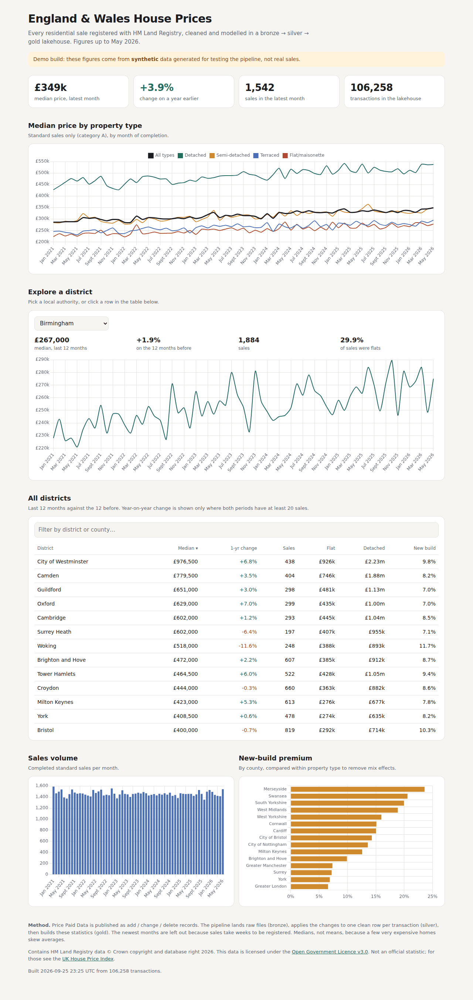
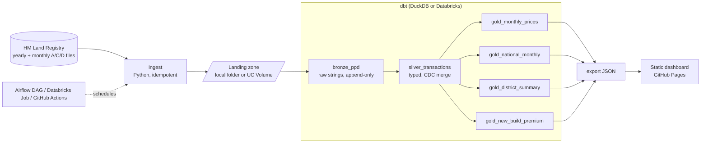

# UK Property Lakehouse

**Live:** <https://usamaattia.github.io/uk-property-lakehouse/>

**A bronze / silver / gold lakehouse for every home sold in England and Wales, built on
HM Land Registry Price Paid Data.**

The same dbt project runs on **DuckDB** (laptop, CI, GitHub Actions) and **Databricks**
(Delta tables in Unity Catalog). A CI job proves both engines produce identical gold
tables. A monthly GitHub Actions run rebuilds everything from the latest data and
publishes a free static dashboard to GitHub Pages.



<sub>Demo build on synthetic data, so the dashboard shows a banner saying so. The published site uses real data.</sub>

---

## Architecture



| Layer | Model | What it does |
|---|---|---|
| Landing | `lakehouse ingest` | Downloads files as-is into `ppd/load_id=<UTC timestamp>/`. SHA-256 dedupe, so the same file is never landed twice. |
| Bronze | `bronze_ppd` | Every line of every file, all columns as strings, plus lineage (`_source_file`, `_load_id`). Append-only and incremental by `load_id`. |
| Silver | `silver_transactions` | One typed row per transaction. Applies add / change / delete records in load order: `MERGE` on Databricks, `delete+insert` on DuckDB. Deletes are soft (`is_deleted`). |
| Gold | `gold_*` | Medians, quartiles, year-on-year change, property-type mix, new-build premium. Standard (category A) sales only. |

## Design decisions

These are worth talking through in an interview.

- **The monthly file is change data capture.** Land Registry publishes additions (A),
  corrections (C) and deletions (D). Silver takes the latest version of each transaction
  by `load_id`, merges on `transaction_id`, and keeps deletes as tombstones so history
  can be audited. A dbt unit test and an end-to-end test prove it.
- **Bronze is strings only.** Nothing is parsed or dropped on the way in, so silver can
  always be rebuilt from bronze without downloading again.
- **Idempotent at every step.** Ingest skips files it has already seen (by hash). Bronze
  and silver only process new `load_id`s. Re-running any step changes nothing, and a test
  checks this.
- **Recent months are held back.** Sales take weeks to be registered, so the newest
  months are incomplete and skewed towards quick, simple sales. Gold ends
  `registration_lag_months` (default 2) before the latest sale seen.
- **Compared like for like.** The new-build premium is computed within each property
  type, then weighted. Otherwise a county that builds mostly flats looks as if its new
  builds are cheap.
- **One SQL codebase, two engines.** Differences are confined to one macro that reads
  files (`read_csv` on DuckDB, `read_files` on Databricks) and one config line (the
  incremental strategy). CI builds the same data on DuckDB and on Apache Spark (the engine
  under Databricks) and checks every gold row matches.
- **Median, not mean.** A few very expensive sales pull averages up a lot, especially in
  London.

## Quick start

```bash
python -m venv .venv && source .venv/bin/activate
pip install -e ".[dev]"

make demo      # synthetic data, no network: land -> dbt build -> export
make serve     # dashboard on http://localhost:8000
```

With real data (downloads a few hundred MB from HM Land Registry):

```bash
make real      # backfills the last 3 years plus the latest monthly update
```

The steps can also be run one at a time:

```bash
lakehouse monthly --backfill-years 3                          # land raw files
dbt build --project-dir transform --profiles-dir transform     # bronze -> silver -> gold + tests
lakehouse export-site                                         # dashboard JSON
lakehouse log                                                 # what has been landed
```

## Testing

| What | Where |
|---|---|
| Ingestion: layout, hashing and dedupe, retries, backfill-once logic, Volume upload | `tests/test_ingest.py` |
| Synthetic generator matches the real file format | `tests/test_synth.py` |
| **End to end on 40 real Price Paid rows:** typing, medians checked against Python, then a monthly change file with a correction, a deletion and a new sale, then a no-op re-run | `tests/test_dbt_pipeline.py` |
| dbt data tests: uniqueness, accepted values, positive prices, no sales dated after their file was landed | `transform/models/**/*.yml` |
| dbt unit tests: cleaning, CDC ordering, year-on-year thresholds | `silver.yml`, `gold.yml` |
| Same gold output on DuckDB and Spark | `scripts/check_engine_parity.py` (CI job `engine-parity`) |
| Airflow DAG imports and has the expected shape | `tests/test_airflow_dag.py` (CI job `airflow`) |

## Running on Databricks

This works on Databricks Free Edition. See [docs/DATABRICKS.md](docs/DATABRICKS.md) for
step-by-step setup.

```bash
databricks bundle deploy --var warehouse_id=<your SQL warehouse id>
databricks bundle run uk_property_monthly
```

The bundle (`databricks.yml`) creates the schema and a landing Volume. It schedules a job
that runs the ingest step on serverless compute, then runs `dbt build` against a SQL
warehouse, writing Delta tables to `workspace.bronze`, `.silver` and `.gold`.

## Publishing the dashboard

1. Push to GitHub.
2. Go to **Settings → Pages → Source: GitHub Actions**.
3. Go to **Actions → Publish dashboard → Run workflow**. Tick *synthetic* for a quick
   first deploy, or leave it unticked for real data.

After that it rebuilds on the 26th of every month.

## Orchestration options

| Where | File | Use when |
|---|---|---|
| GitHub Actions | `.github/workflows/publish.yml` | Free, and simplest for the public site |
| Airflow 3 | `orchestration/airflow/dags/uk_property_lakehouse.py` | You already run Airflow or MWAA. Skips dbt when nothing new landed. |
| Databricks Jobs | `databricks.yml` | Production on Databricks |

## Project layout

```
src/lakehouse/        ingest, landing zone (local or Volume), synthetic data, site export, CLI
transform/            dbt project: macros, seeds, bronze/silver/gold models, tests
orchestration/        Airflow DAG, Databricks job entry point
site/                 static dashboard (HTML + Chart.js), data/ is generated
scripts/              engine parity check
tests/                pytest, including a real-data fixture
```

## Roadmap

- [ ] Auto Loader / streaming tables for bronze on Databricks
- [ ] Join ONS earnings data to show affordability ratios per district
- [ ] Compare gold medians against the official UK House Price Index as a sanity check
- [ ] Postcode-level drill-down with a map
- [ ] dbt model contracts on the gold layer

## Data licence

Contains HM Land Registry data © Crown copyright and database right 2026. This data is
licensed under the [Open Government Licence v3.0](https://www.nationalarchives.gov.uk/doc/open-government-licence/version/3/).
The dashboard publishes aggregates only, never individual addresses. The test fixture
contains 40 rows of public Price Paid Data.

## License

Code: MIT
